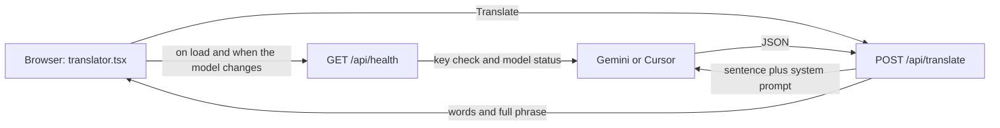

# translategemma

This Next.js app is one page. The browser draws the translator, and a small server route calls Gemini so the API key never reaches the browser.

## What Next.js is doing here

Next.js is React plus a server. A file’s place under `src/app/` is its URL:

| File | URL | Runs |
| --- | --- | --- |
| `src/app/page.tsx` | `/` | Server, then sends HTML |
| `src/app/layout.tsx` | wraps every page | Server |
| `src/app/api/health/route.ts` | `GET /api/health` | Server only |
| `src/app/api/translate/route.ts` | `POST /api/translate` | Server only |
| `src/app/icon.png` | browser tab icon | Static file |

`layout.tsx` is the shell: the HTML document, the Source Sans font, and the tab title `translategemma`. `page.tsx` only renders the translator.

`translator.tsx` starts with `"use client"`. That component runs in the browser. It holds the text box, the language and model menus, and the translation result. The server components (`layout`, `page`, the API routes) never ship `GEMINI_API_KEY` or `CURSOR_API_KEY` to the browser.

Shared code lives in `src/lib/` and is imported with `@/`, which means `src/`:

- `languages.ts` — the five language pairs and their prompts
- `models.ts` — model names. Gemini stays the default (`gemini-3.5-flash-lite`). Composer 2.5 and Grok 4.6 use the Cursor key
- `cursor-translate.ts` — checks the Cursor catalog and runs a one-shot translation for those two models
- `translation.ts` — the JSON shape Gemini must return, and how that JSON is parsed
- `gemini-error.ts` — turns Gemini failures into short messages

## What happens when you open the page

On load, the browser calls `/api/health?model=...`. Gemini models use `GEMINI_API_KEY`. Composer 2.5 and Grok 4.6 use `CURSOR_API_KEY` and the Cursor model catalog. The sidebar then shows the green “API OK” box or a red error, and Translate stays disabled until both the key and the model are accepted.

Changing the model repeats that check. Changing the language only updates labels, the prompt, and the special-character buttons. It does not call Gemini.

## What happens when you click Translate

The browser sends JSON: the sentence, the language code such as `de-uk`, and the model name.

`/api/translate` then:

1. Rejects the request if the key for that model is missing or the text is empty.
2. Loads that pair’s prompt from `languages.ts`.
3. Gemini calls `generateContent` with a JSON schema. Cursor models call `Agent.prompt` in an empty temp folder and are told to return the same JSON.
4. The reply must match the schema in `translation.ts`: `original_phrase`, `words` (each with `word`, `translation`, and an optional `explanation`), and `full_phrase_translation`.
5. Gemini responses include token counts. Cursor responses return the translation without a token line.

The browser clears the text box and draws the word list, the full phrase, the token line, and the elapsed time. If the JSON is the wrong shape, the route returns status 422 and the page shows the raw model text.

The API key stays in the route file’s `process.env`. Anything in `translator.tsx` is visible to anyone using the site, so the key must not be referenced there.

## How you run it

`npm run dev` starts a local server with hot reload, usually at http://localhost:3000. `npm run build` then `npm start` is the production mode Vercel uses. The Dockerfile sets `NEXT_STANDALONE=1` and builds with Webpack so the image can run as a small standalone server. Vercel does not set that flag, so its build stays a normal Next.js build.
